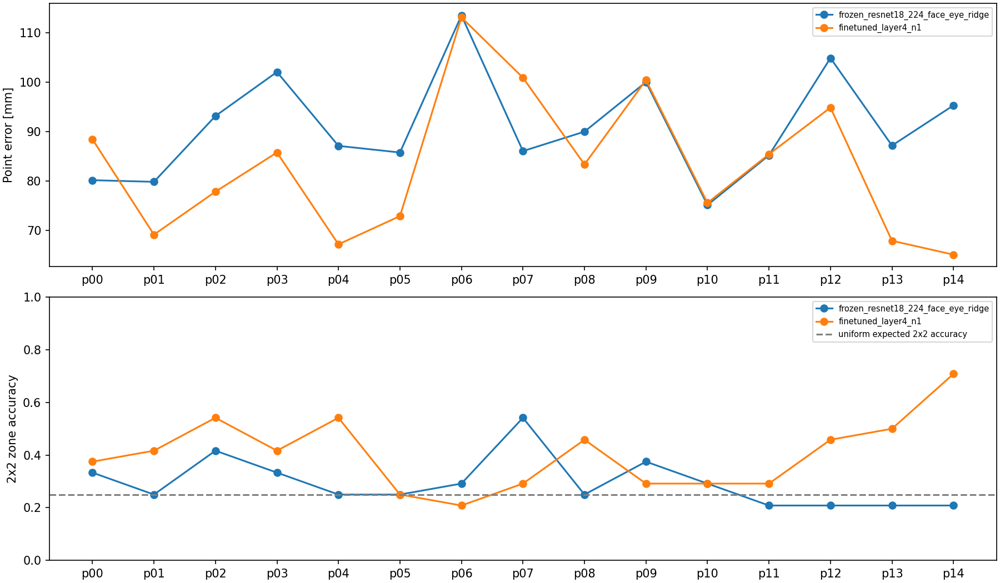

# MPIIFaceGaze next-stage results

本报告只使用本地 360 张图片、15 名参与者和完整 37,667 条标注。没有新增数据集下载，没有修改官方标签，没有覆盖旧 H1/H2/H3 结果。静态图片不能验证 dwell time、gaze stability 或距离变化。

## 数据完整性与越界审计

独立读取原始 txt：37667 条合法格式，0 条格式错误；连续屏幕范围 `[0,W]×[0,H]` 越界 243 条，像素中心 `[0,W-1]×[0,H-1]` 未增加越界样本。59 条恰在连续边界（单独保留）。轴分布：{'y': 74, 'x': 143, 'x+y': 26}。

| Subject | 全标注 | 越界 | 比例 | 含异常采集日（day ID:数量） |
|---|---:|---:|---:|---|
| p00 | 2927 | 0 | 0.000% |  |
| p01 | 2904 | 0 | 0.000% |  |
| p02 | 2916 | 5 | 0.171% | day21:5 |
| p03 | 2929 | 0 | 0.000% |  |
| p04 | 2860 | 0 | 0.000% |  |
| p05 | 2870 | 0 | 0.000% |  |
| p06 | 2877 | 0 | 0.000% |  |
| p07 | 2843 | 228 | 8.020% | day02:11, day04:6, day06:16, day07:5, day11:15, day12:28, day13:5, day14:8, day15:18, day17:9, day19:17, day21:4, day23:9, day38:31, day47:11, day50:16, day55:8, day56:11 |
| p08 | 2767 | 0 | 0.000% |  |
| p09 | 2719 | 0 | 0.000% |  |
| p10 | 2194 | 10 | 0.456% | day05:10 |
| p11 | 2262 | 0 | 0.000% |  |
| p12 | 1601 | 0 | 0.000% |  |
| p13 | 1498 | 0 | 0.000% |  |
| p14 | 1500 | 0 | 0.000% |  |

243 条标签均无本地照片；几何一致数 243/243，最大重建差 0.00000387 px。它说明 2D/3D 标注及当前投影实现互相一致，**不是 gaze 预测准确率，也不能证明物理注视正确**。

### 与公开实现的比较及原因边界

[pperle 的实际错误脚本](https://github.com/pperle/gaze-tracking/blob/6e4e2a5ca355680721798556fa671e8266de5705/dataset/mpii_face_gaze_errors.py)已固定版本保存到 `mpii_audit/reference/`（含许可和 revision）。其数值规则是整数截断后使用闭区间；按本地全部标注逐 ID 比较，243 个 ID 完全一致。它同时假定排序后的每张图片依次对应 txt 下一行；现有稀疏图片不满足这一条件。直接执行原脚本仅输出两个错误 ID，两者实际官方标签都在屏幕内，故不能将稀疏运行结果用作清理列表。
排序图片/标注位置不匹配 360 次；两个误报：Data/p07/day47/0671.jpg, Data/p07/day50/0241.jpg。
README 公开链接中的异常 CSV 已获取（11,445 bytes，引用资料而非新增照片），与本地审计 **243/243 个 ID、原始坐标及屏幕尺寸全部一致**，源码/CSV 来源与SHA256记录在 audit_summary.json。公开 README 同样指出 p02/p07/p10，但其比例 .043%/8.79%/.39% 与本地 FaceGaze 完整标注比例不相等；分母或版本差异仍 unresolved。
异常集中在 20 个 subject/day：p02 day21、p10 day05、p07 的 18 天。其他 12 人全部检查且无越界。day 是采集会话名，不是已知日历日期。局部日集中支持采集条件相关性的进一步核查；每人仅一套 calibration，缺少逐日屏幕配置日志和异常照片，不能确定是屏幕配置变化还是标签生成错误。共享的标定偏差可以同时影响 2D 与 3D，几何一致不能排除它。两个假设均标为 unresolved；一像素边界约定不能解释这 243 条。

全部243条都向右/下越界，无左/上越界；各人越界坐标范围：{'p02': {'x_min': 296.0, 'x_max': 2809.0, 'y_min': 391.0, 'y_max': 910.0}, 'p07': {'x_min': 25.0, 'x_max': 1906.0, 'y_min': 9.0, 'y_max': 1079.0}, 'p10': {'x_min': 14.0, 'x_max': 3035.0, 'y_min': 153.0, 'y_max': 1157.0}}。这区别于零均值的一像素扰动，但不足以确定真实屏幕配置。逐日坐标最值与屏幕尺寸已写入 CSV，可用于后续对照独立设备日志。

## 数据清理：相同测试集与测试难度分开

完整标注视图数量：{'Original': 37667, 'On-screen': 37424, 'Day-filtered': 36223}；当前图片视图：{'Original': 360, 'On-screen': 360, 'Day-filtered': 350}。Original 与 On-screen 完全相同；不能用当前图片测试删除 243 张异常照片的效果。Day-filtered 删除 10 张标签合法、但采集日含异常的图片。仅 manifest/sample IDs 实现视图，不产生修改过的官方数据。

全标注按日过滤共排除1444条，其中1201条本身在屏幕内；不能把同日所有标签都认定错误。该策略可能同时改变训练分布与测试难度，故必须单独做敏感性分析。

清理前后每名参与者的样本数、采集日数、归一化gaze坐标均值/标准差分为完整标注与本地图片两层，见 `mpii_next/cleaning/view_distributions.csv`。

统一 15 折 LOSO：每折测试 1 人、内部验证相邻 1 人、训练其余 13 人（312/24/24）；不把验证集重新并入训练。所有新实验使用同一个 splits.json 的 sample IDs 和哈希。清理对照固定 alpha=100；训练视图改变，360 个 OOF 测试样本保持相同。

| 模型 | Original训练，测试360 | On-screen训练，测试360 | Day-filtered训练，测试360 | Day-filtered减Original [95% CI] | Original训练，仅测试350 |
|---|---:|---:|---:|---|---:|
| pixels32x24_ridge | 14.008° | 14.008° | 13.946° | -0.062 [-0.220, 0.071]° | 14.076° |
| landmarks_head_pose_ridge | 11.266° | 11.266° | 11.278° | 0.012 [-0.010, 0.035]° | 11.330° |
| face_eye_cnn_ridge | 12.548° | 12.548° | 12.419° | -0.129 [-0.337, 0.094]° | 12.584° |

负差值表示降低误差。上述区间为固定 OOF 预测的参与者配对 bootstrap（2,000 次），不重新训练，属于描述性证据；不能将极小均值变化称为显著改善。最后一列只改测试集合，反映难度/构成变化，不是训练清理收益。
额外 24 张/人、共 360 张的计划预计传输 42.59 MiB；按已观察最大文件估计 58.57 MiB（均非保证上界）。实际新增下载 0。默认只写计划；必须显式 --allow-download、独立目录且设字节预算才请求。当前训练器读取原 360 manifest；扩展目录尚未接入模型训练，不能声称扩大实际下载数据带来收益。

## 更强的图像预测与几何一致性

先纠正旧结果的条件：旧5折 face_eye_cnn_ridge 实际为12.241°，train_mean为12.370°；约11°来自 appearance_head_pose_ridge=11.063°，包含标注估计head pose，不能称为纯图像或全自动精度。这里改变为带内部验证的 LOSO，数值不能直接当成前后改善。360 张只覆盖完整图片集极小部分；ImageNet 分类特征、低分辨率、跨人差异和小样本都是限制。没有证据把旧误差主要归因于这 243 条标签，因为它们没有进入现有图片集合。
所有 appearance 模型使用**标注六点定位的 face/eye crops**。没有预测 landmarks，不能声称全自动 gaze。oracle pose 是官方六点人脸模型估计的旋转/平移，并非独立动捕真值。predicted pose 仅本折训练人内部做分组 OOF stacking 的 Ridge 诊断，测试 pose 不作为输入；可靠外部 pose 预测器尚未完成。known hardware calibration 是相机内参/屏幕外参和尺寸，区别于用测试用户真实 gaze 点做 user-specific calibration（本次没有）。
冻结模型：训练人拟合 scaler/PCA32，alpha∈{10,100,1000} 由内部验证人选择；原低分辨率 Ridge 保留 alpha100。神经网络使用 ImageNet 初始权重、64px 三 crops，共享 ResNet18；只微调 layer4+1536→128→8 head，stem 与 BN 统计冻结。matched frozen 对照用相同输入/头。lr∈{1e-4,3e-4}、对应 wd∈{1e-4,1e-3} 两组配置联合选择，最多12 epoch，patience3；不代表穷尽超参搜索。所有选择只看验证人 angular error。测试监督在训练函数中置 NaN；无 MPII gaze 预训练权重。
回归目标为方向3维、归一化屏幕点2维、相机坐标 gaze origin 3维；神经损失 `1-cos(direction)+0.2*MSE(screen_uv)+10*MSE(origin_m)`。没有添加几何一致性损失，因此也没有该 loss 的因果消融结论。

| 模型 | 角度 mean / median / p90 (°) | 直接2D mean px / mm | 预测origin ray有效率 | ray全部样本 mean px / mm（失败罚） | ray与2D平均差px（有效子集） |
|---|---:|---:|---:|---:|---:|
| training_mean | 12.269 / 11.663 / 20.031 | 441.7 / 91.9 | 100.00% (0失败) | 454.8 / 94.5 | 91.1 |
| original_pixels32x24_ridge | 14.008 / 12.362 / 23.254 | 541.1 / 112.0 | 98.61% (5失败) | 540.2 / 111.8 | 174.8 |
| landmark_oracle_head_pose_ridge | 11.336 / 10.546 / 18.910 | 443.4 / 92.1 | 100.00% (0失败) | 456.4 / 94.8 | 100.7 |
| frozen_resnet18_224_face_eye_ridge | 12.463 / 12.011 / 20.942 | 437.8 / 91.0 | 100.00% (0失败) | 447.3 / 93.0 | 111.2 |
| appearance_oracle_head_pose_ridge | 11.440 / 10.949 / 19.874 | 442.7 / 92.0 | 100.00% (0失败) | 452.6 / 94.1 | 118.1 |
| appearance_known_hardware_calibration_ridge | 12.880 / 12.244 / 21.924 | 462.2 / 96.3 | 100.00% (0失败) | 477.4 / 99.5 | 108.5 |
| frozen_resnet18_224_face_eye_ridge_n0.5 | 12.518 / 11.988 / 21.529 | 444.5 / 92.3 | 100.00% (0失败) | 452.6 / 94.0 | 105.2 |
| appearance_predicted_pose_crossfit_diagnostic | 12.459 / 12.234 / 20.386 | 440.4 / 91.5 | 100.00% (0失败) | 450.2 / 93.5 | 107.5 |
| matched_frozen_head_n0.5 | 12.732 / 12.072 / 20.840 | 444.6 / 92.4 | 100.00% (0失败) | 464.8 / 96.6 | 133.4 |
| matched_frozen_head_n1 | 12.649 / 12.040 / 20.956 | 441.2 / 91.7 | 100.00% (0失败) | 463.5 / 96.3 | 148.4 |
| finetuned_layer4_n0.5 | 12.397 / 12.091 / 21.029 | 434.1 / 90.2 | 100.00% (0失败) | 452.5 / 94.1 | 145.0 |
| finetuned_layer4_n1 | 12.049 / 10.908 / 19.820 | 400.6 / 83.2 | 100.00% (0失败) | 422.8 / 87.8 | 126.5 |

ray 使用**模型预测 origin**和方向，通过已知硬件 calibration 求交；没有用测试 face center 代替模型 origin。官方 origin 的 conditional/oracle ray 只在 JSON 独立字段保留。失败 ray 在总数中保留，分类计错，误差替代统计按一个屏幕对角线惩罚；若存在失败，无条件原始均值未定义。几何有效指前向、有限的平面交点，不保证在显示范围内；JSON另存on_screen_fraction_of_all。有效但远超屏幕的点不裁剪、不隐藏。预测 origin ray 与直接二维头差距量化几何不一致，并不保证投影头更准。逐样本误差、无效 rays、worst20 与每人指标均单独保存。

### 微调、样本数与 oracle advantage

| 比较（左减右） | mean angular Δ° | 参与者配对95% CI |
|---|---:|---|
| finetuned_layer4_n1 minus matched_frozen_head_n1 | -0.600 | [-1.474, 0.200] |
| finetuned_layer4_n1 minus finetuned_layer4_n0.5 | -0.348 | [-1.220, 0.433] |
| finetuned_layer4_n1 minus training_mean | -0.219 | [-1.190, 0.646] |
| frozen_resnet18_224_face_eye_ridge minus training_mean | 0.194 | [-0.173, 0.567] |
| matched_frozen_head_n1 minus matched_frozen_head_n0.5 | -0.083 | [-0.493, 0.476] |
| appearance_oracle_head_pose_ridge minus appearance_predicted_pose_crossfit_diagnostic | -1.019 | [-1.482, -0.560] |
| appearance_oracle_head_pose_ridge minus frozen_resnet18_224_face_eye_ridge | -1.023 | [-1.577, -0.509] |
| appearance_predicted_pose_crossfit_diagnostic minus frozen_resnet18_224_face_eye_ridge | -0.004 | [-0.235, 0.190] |
| appearance_known_hardware_calibration_ridge minus frozen_resnet18_224_face_eye_ridge | 0.417 | [-0.307, 1.377] |
| frozen_resnet18_224_face_eye_ridge minus frozen_resnet18_224_face_eye_ridge_n0.5 | -0.055 | [-0.370, 0.267] |

实际微调减匹配冻结对照：-0.600°，95% CI [-1.474, 0.200]；没有足够证据宣称跨参与者显著改善。

微调收益必须对比同64px输入/相同头的 frozen control。样本数实验仅在已有图片内把每个训练人从12增至24张（156→312），验证/测试不变；不能外推为新增数据下载的收益，也不应以224px Ridge对64px网络解释纯微调效果。CI 包含0时不能声称显著改善。oracle pose 对比只能量化此小样本条件的信息优势；由于没有预测 landmarks，标注 crop localization 的 oracle advantage **无法量化**。

### 参数与推理开销

编码器共享参数 11,176,512；三 crops 单样本 CPU(4 threads)编码器基准：64px median 6.41 ms，224px median 42.45 ms。不含解码、landmark 检测、裁剪、相机传输和投影，不能当作手机端端到端延迟。

| 模型 | 参数范围/数量 | 已缓存特征后的median耗时ms |
|---|---|---:|
| training_mean | encoder 0; Ridge max 8 | 未测（常数输出） |
| original_pixels32x24_ridge | encoder 0; Ridge max 6,152 | 0.042 |
| landmark_oracle_head_pose_ridge | encoder 0; Ridge max 152 | 0.039 |
| frozen_resnet18_224_face_eye_ridge | encoder 11,176,512; Ridge max 264 | 0.070 |
| appearance_oracle_head_pose_ridge | encoder 11,176,512; Ridge max 312 | 0.107 |
| appearance_known_hardware_calibration_ridge | encoder 11,176,512; Ridge max 464 | 0.106 |
| frozen_resnet18_224_face_eye_ridge_n0.5 | encoder 11,176,512; Ridge max 264 | 0.072 |
| appearance_predicted_pose_crossfit_diagnostic | encoder 11,176,512; Ridge max 312 | 0.107 |
| matched_frozen_head_n0.5 | total 11,374,280; trainable 197,768 | 0.016 |
| matched_frozen_head_n1 | total 11,374,280; trainable 197,768 | 0.014 |
| finetuned_layer4_n0.5 | total 11,374,280; trainable 8,591,496 | 3.064 |
| finetuned_layer4_n1 | total 11,374,280; trainable 8,591,496 | 3.454 |

Ridge 计数未包含 PCA/scaler 数组；predicted-pose 条件另有 PCA+198系数 pose probe。总编码器时间与缓存 tail 时间有重叠，不可相加作精确端到端计时。各折原始配置、epoch、训练秒数和选择过程在 strong_results.json / folds 中。

## 粗粒度 user-state 任务

标签仍由官方 gaze target 生成，只测定位能力，**不是困难标签**。Macro-F1 固定全部网格类，balanced accuracy 对当前评分集有真值支持的类平均；越界/失败预测计错。先独立验证集选 C∈{.1,1,10} 的线性 zone classifier，再与回归头离散化比较。每人指标和混淆矩阵在 JSON。

| Task | 模型 | Macro-F1 | Balanced accuracy | Accuracy | 理论uniform accuracy |
|---|---|---:|---:|---:|---:|
| 2x2 | training_prior | 0.162 | 0.222 | 0.256 | 0.250 |
| 2x2 | uniform_random_seed42 | 0.258 | 0.263 | 0.258 | 0.250 |
| 2x2 | direct_frozen_CNN_zone_classifier | 0.310 | 0.313 | 0.328 | 0.250 |
| 2x2 | frozen_resnet18_224_face_eye_ridge:direct_head | 0.294 | 0.296 | 0.294 | 0.250 |
| 2x2 | finetuned_layer4_n1:direct_head | 0.396 | 0.397 | 0.403 | 0.250 |
| 2x2 | finetuned_layer4_n1:predicted_origin_ray | 0.358 | 0.360 | 0.356 | 0.250 |
| 3x3 | training_prior | 0.044 | 0.102 | 0.128 | 0.111 |
| 3x3 | uniform_random_seed42 | 0.109 | 0.110 | 0.111 | 0.111 |
| 3x3 | direct_frozen_CNN_zone_classifier | 0.160 | 0.166 | 0.172 | 0.111 |
| 3x3 | frozen_resnet18_224_face_eye_ridge:direct_head | 0.092 | 0.148 | 0.150 | 0.111 |
| 3x3 | finetuned_layer4_n1:direct_head | 0.125 | 0.168 | 0.167 | 0.111 |
| 3x3 | finetuned_layer4_n1:predicted_origin_ray | 0.172 | 0.180 | 0.175 | 0.111 |
| 4x4 | training_prior | 0.009 | 0.042 | 0.058 | 0.062 |
| 4x4 | uniform_random_seed42 | 0.072 | 0.072 | 0.069 | 0.062 |
| 4x4 | direct_frozen_CNN_zone_classifier | 0.069 | 0.074 | 0.083 | 0.062 |
| 4x4 | frozen_resnet18_224_face_eye_ridge:direct_head | 0.050 | 0.090 | 0.092 | 0.062 |
| 4x4 | finetuned_layer4_n1:direct_head | 0.047 | 0.070 | 0.072 | 0.062 |
| 4x4 | finetuned_layer4_n1:predicted_origin_ray | 0.054 | 0.063 | 0.067 | 0.062 |
| left_center_right | training_prior | 0.271 | 0.307 | 0.311 | 0.333 |
| left_center_right | uniform_random_seed42 | 0.308 | 0.308 | 0.308 | 0.333 |
| left_center_right | direct_frozen_CNN_zone_classifier | 0.322 | 0.322 | 0.322 | 0.333 |
| left_center_right | frozen_resnet18_224_face_eye_ridge:direct_head | 0.198 | 0.336 | 0.333 | 0.333 |
| left_center_right | finetuned_layer4_n1:direct_head | 0.369 | 0.411 | 0.411 | 0.333 |
| left_center_right | finetuned_layer4_n1:predicted_origin_ray | 0.391 | 0.411 | 0.411 | 0.333 |



| Subject | 冻结224px角度mean° | 冻结224px点误差mm | 直接zone分类2x2 accuracy |
|---|---:|---:|---:|
| p00 | 11.19 | 80.17 | 0.375 |
| p01 | 9.72 | 79.84 | 0.375 |
| p02 | 11.89 | 93.16 | 0.458 |
| p03 | 17.31 | 102.07 | 0.333 |
| p04 | 10.94 | 87.12 | 0.375 |
| p05 | 9.74 | 85.78 | 0.250 |
| p06 | 12.80 | 113.51 | 0.375 |
| p07 | 11.06 | 86.06 | 0.417 |
| p08 | 14.57 | 89.99 | 0.250 |
| p09 | 13.15 | 100.03 | 0.292 |
| p10 | 9.98 | 75.15 | 0.333 |
| p11 | 12.32 | 85.21 | 0.250 |
| p12 | 13.91 | 104.89 | 0.208 |
| p13 | 13.11 | 87.18 | 0.333 |
| p14 | 15.26 | 95.31 | 0.292 |

直接2x2分类 accuracy=0.328（uniform期望0.25，训练prior=0.256），Macro-F1=0.310。这仍有大量错误，不能认定当前 gaze zone 已满足实际干预要求；比较时也要查看左中右、3x3和4x4的prior与balanced accuracy。

预先定义的微调screen head离散化为2x2后：accuracy=0.403、Macro-F1=0.396；相对训练prior的参与者accuracy差 0.147，描述性95% CI [0.050, 0.239]。该模型按内部验证angular而非测试zone分数选配置；仍约六成分区错误，不能据此声称部署可用。粗定位相对prior的证据比精确angular改善更有希望，但它测量的仍是定位，不是困难。

| Task | classifier减prior的参与者平均accuracy差 | 95% CI |
|---|---:|---|
| 2x2 | 0.072 | [0.017, 0.131] |
| 3x3 | 0.044 | [0.011, 0.081] |
| 4x4 | 0.025 | [-0.011, 0.058] |
| left_center_right | 0.011 | [-0.042, 0.058] |

| Appearance辅助任务 | yaw MAE° | pitch MAE° | rotation geodesic° | distance proxy MAE mm |
|---|---:|---:|---:|---:|
| appearance_pose_distance | 9.89 | 9.83 | 16.78 | 48.31 |
| training_mean | 9.89 | 9.50 | 16.41 | 74.82 |

距离proxy相对训练均值的参与者MAE差：-26.51 mm，95% CI [-32.13, -20.77]。属于静态估计标签上的描述性结果；头姿误差应另看上表，不将距离结果外推到所有 user-state 特征。

yaw/pitch 为相机坐标旋转的 extrinsic y-x-z Euler 前两分量；距离是估计 face center 的模长，既非真实 phone-eye 距离，也非 relative distance change。以上只测对官方估计标签的拟合。zone classifier 使用训练人拟合的 whitened PCA32；所有候选均限制5000迭代，迭代数/是否达到上限写入日志。初次未whiten版本有收敛警告，最终版本改为固定whiten预处理，不据测试结果选择C。
结构性 camera checks：{'passed_structural_checks': 360}。缺少自然失败正例，sensitivity/specificity 未定义；仅实现文件缺失、解码、恒定图像和 landmark 合法性检测，未验证真实遮挡/人脸丢失识别。

当前模型的屏幕点误差仍很大；较粗分区降低定位精度要求，但应依据上表相对 prior 的跨人提升判断可用性，不能仅因任务更粗就声称足够好。优先把粗 gaze zone、头姿、静态距离 proxy 和 missing flag 作为未来低成本候选；本次无法证明精确 gaze 是适应帮助的必要条件，也无法证明粗特征足够。需在真实困难识别上做 precision gaze vs coarse state 的受控消融。

## 仍缺什么才能支持 User-Camera + Screen-Stream 论文

需要同一用户/设备/时间的 Camera、Screen、Actions 同步数据，独立困难/帮助时机与类型标签，跨参与者/任务/应用测试，以及可部署的预测 landmarks、pose 和可靠缺失处理。笔记本摄像头的安装、屏幕尺寸/距离、视角和照明不等于手持手机；持机运动、遮挡、老年群体与视觉能力差异均未验证。需要真实连续流才能评估 dwell/stability/distance change；需在相同 screen+action baseline 上检验 camera 的增益和干预代价。本次没有招募/GUI Agent/GRPO，也没有拿 synthetic H2/H3 证明真实 Camera 价值。
尚未完成：额外图片下载及扩展manifest训练入口、完整骨干微调/更大数据、gaze-specific架构（可选）、预测landmark crops、可靠外部pose模型、几何loss消融、真实失败检测评估、手机迁移与同步困难识别验证。已完成的 layer4 微调和156/312样本学习曲线只针对当前360张诊断集。

## 可复制命令

```bash
cd /Users/audrey/Desktop/Phone
PYTHONDONTWRITEBYTECODE=1 .venv/bin/python -m usercamera mpii-audit-outliers
PYTHONDONTWRITEBYTECODE=1 .venv/bin/python -m usercamera mpii-compare-cleaning
PYTHONDONTWRITEBYTECODE=1 .venv/bin/python -m usercamera mpii-strong-baselines --max-epochs 12
PYTHONDONTWRITEBYTECODE=1 .venv/bin/python -m usercamera mpii-coarse-eval
PYTHONDONTWRITEBYTECODE=1 PYTEST_DISABLE_PLUGIN_AUTOLOAD=1 .venv/bin/python -m pytest -q
```

默认不下载数据；首次训练需本地原360图片/标注/calibration及已缓存 ImageNet 权重。已有 fold cache 按源码/输入/训练与验证标签/配置指纹复用。结果与日志可重建；没有输出可部署的最终统一模型checkpoint。可选扩展**尚未执行**：
```bash
.venv/bin/python -m usercamera mpii-compare-cleaning --extra-per-subject 24 --allow-download --download-budget-mib 64 --expansion-dir data/expansions/mpii_v1
```

扩展写入独立目录并拒绝覆盖；先用不含 --allow-download 的命令检查 expansion_plan.json。输出：mpii_audit 的逐条越界/日期表/图/源码；mpii_next 的共享 splits、cleaning 对照、strong 全部模型/逐人/逐样本错误、coarse 全部任务。历史报告均保留。

实际校验：465个原始文件、69个历史报告SHA256未变化；测试输出：`44 passed in 4.57s`。完整记录见 `mpii_next/verification.json`。
