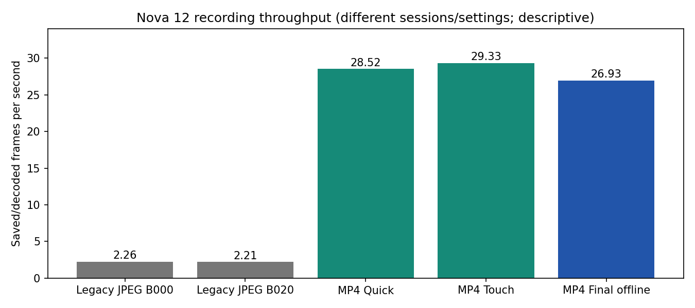
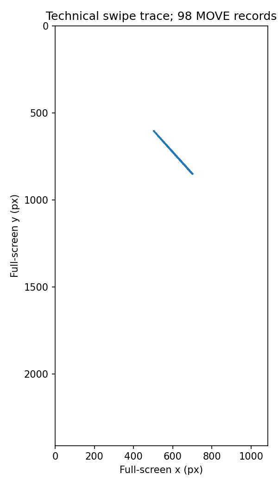

# Mobile Pilot v2 — 实际结果

真机视频验证：2026-10-27；收尾修正与无相机真机回归：2026-10-29（Asia/Shanghai）。基于现有项目增量开发；未修改 MPIIFaceGaze 结果，未开展 GUI Agent/GRPO 训练。

## 最终 APK / 构建

- APK：`mobile_pilot/app/build/outputs/apk/debug/app-debug.apk`（59,398,622 bytes），已覆盖安装，旧 Session 保留。
- SHA-256：`073aace529c88f7177814a787b889edec1f967358b7bad537c5abd034f0eab56`。设备已安装包 hash 与本地一致。
- 构建：`./gradlew testDebugUnitTest assembleDebug` 成功；[当前构建日志](build_release.log)。JVM 6 tests 成功；Python 89 passed in 4.42s（[日志](python_release_tests.log)）。
- 最终合并 Manifest 仅 CAMERA 与本 App 非导出动态接收器权限；无 INTERNET/ACCESS_NETWORK_STATE/RECORD_AUDIO。MediaPipe 依赖带入的网络权限已显式移除，并加入合并权限回归测试。
- [当前构建及源码指纹](release_build_verification.json) · [10月27日录像包指纹](build_verification.json) · [最初完整 Quick Test 的 APK 指纹](quick_test_build.json)。

## nova 12 实测（10月27日录像；保留原始包指纹）

HUAWEI BLK-AL00 / API31，前置相机 H.264 MP4、720×1280、无音轨。以下全为真实设备录像，不是 mock；因包含 ADB 和非受控操作、部分主观填写，统一视为功能试跑，不能作为困难识别或干预效果数据。

| 功能试跑 | 解码帧数 | PTS时长(s) | FPS | >75ms缺口 | Live结果 |
|---|---:|---:|---:|---:|---:|
| 完整 Quick Test | 3805 | 133.385 | 28.52 | 1 | 297 |
| Touch/六种帮助回归 | 2950 | 100.559 | 29.33 | 0 | 209 |
| 最终离线 APK 短测 | 693 | 25.695 | 26.93 | 0 | 59 |

10月27日离线包短测并非完整 Quick Test：完成5个 instructed fixation 并在首个搜索实施语义说明后主动退出，保留 aborted_stop。完整 Quick Test（5个Fixation + 9项搜索、另含暂停重做）和六种帮助回归来自前两个包版本；不能把不同 APK 哈希混为同一次测量。

旧真实 Session 两项 JPEG 保存率为2.26/2.21 FPS；新模式的实测吞吐如表。不同 Session/设置，仅描述录制吞吐，不是严格配对的人类任务效果比较。

VideoCapture+ImageAnalysis 在本 nova 12 同时绑定成功；10月27日无网络权限包有59条 Live结果，CPU LIVE_STREAM 推理可用。推理延迟统计是推理提交到回调，未包含前置位图转换成本；不能等同整条在线管道延迟。检测阈值不当成逐帧 confidence，真实 confidence/逐眼 visibility 无可靠输出时保持 null；头姿是 canonical-face proxy、脸尺度是相对量。

## 10月29日收尾修正

- 修正提高对比度/高亮后的 UI 元素颜色及对比度元数据，保留 `planned_foreground_gray`。在明确无相机模式下真机验证：实际黑字灰度0、对比度21、计划灰度保留；没有录制人脸视频。[真机检查记录](metadata_regression.json)。
- 修正 GRU 序列的 UI 截止边界，最后一个序列步也只读取严格早于 prefix cutoff 的状态；新增完整管道边界测试。
- v2 评估拒绝混合证据层级；即使人为提供“已验证时钟”，device-smoke/mock 也不能作为真实研究数据进入训练。
- 当前交付 APK 是上述元数据修正版；视频实测三份 ZIP 保持不变、来自先前包。录制模块没有改动，但没有重录一份当前 APK 的视频，也不能将旧 FPS 伪称为当前包重新测量。10月27日离线实测包另存 `data/private/pilot_v2/apks/offline_tested_65bb11e.apk`，指纹 `65bb11eaa49ce53ccf30045eb0f811e22525df63919d3bb4308fa1fcecd2f4d2`。

## 同步 / 导出 / 回放

每份真实 ZIP 均经过 CRC、逐文件 size/hash、全部 MP4 帧解码和 encoded PTS 逐项一致检查。Start/Pause/Resume/Finalize、UI draw/版本、Touch、Help、Assistance、Feedback 各保留原时钟和来源。第一份记录1次暂停与1次恢复，分段估计避免跨暂停使用单一偏移。

**物理同步仍 unverified。** Recorder回调到达时间+累计duration只支持估计；独立 sensor↔encoded PTS 配对、曝光/屏幕光子锚点均未获得。最终短测中估计最近帧残差：搜索 onset约12.37ms、help约14.54ms、offset约365.03ms；它们是估计覆盖检查，绝不是实测物理同步误差。整体 uncertainty=null，融合模型评估因此被阻止。旋转元数据/portrait解码已检查，实际镜像需独立视觉验证。

真实导出（含前摄人脸，仅本地私有保存）：
- `data/private/pilot_v2/device_smoke_v2_20261027_154431.zip`；ZIP SHA256 `472ebdb59a132724c08f5d3b4d14ddd6c7c72139ea622ba65e7e0ebcb00ff19c`。
- `data/private/pilot_v2/device_smoke_touch_20261027_155850.zip`；ZIP SHA256 `bc91c9347f9d914ca4ce4ca5766bb3db0866ce0b38f074c3989ab7396913865e`。
- `data/private/pilot_v2/device_smoke_offline_20261027_160605.zip`；ZIP SHA256 `021476c7b2d23f95e1e605434282c280f73dc8b6968848c40fe71b6ef84f6f6a`。

回放：[完整 Quick Test](private/replay/device_smoke_v2_20261027_154431/index.html) · [最终离线包短测](private/replay_final/device_smoke_offline_20261027_160605/index.html)。支持视频、UI版本、实际截图、Touch点、Help事件与说明/问卷/休息页；需显式接受估计映射。浏览器已实际播放第一份并显示对应 Fixation / Search UI。

## 任务 / 帮助 / 质量

Task A 的指导独立于白底单黑点页；5/9/25点、1/2/3轮可配置。Task B 有独立指导、Quick/Full、进度、分块休息、跳过/退出、多选困难类型。单屏搜索不再默认标成 navigation。

匹配设计按 font / position / contrast / assistance 分 pair，每个 pair 内只改指定因素；保留 pair_id/condition_id/seed。初始帮助分配不看未来行为。偏好适应模式使用过去偏好，并随机保留no_help/preferred/other；尚未验证实际干预收益，重复目标的学习/顺序效应仍在。

Touch回归包含98条MOVE、pointer ID/history、View-local/full-screen/normalized坐标；坐标和uptime→elapsed映射通过校验。六种帮助均实际交付，并有成对干预onset/end及前后UI版本：highlight / zoom / contrast / enlarge_touch / explain / none。10月27日离线包单独验证语义说明实际显示“安排检查项目的预约时间。此为模拟服务入口。”

**Fixation QC警示：** 每项约44–45帧录像，但 strict full-face proxy 为false；最终包59条Live结果均有脸且双眼in-frame proxy=1，仍不满足本轮完整面部代理标准。具体是脸边缘裁切还是代理阈值不适合，需要人工查看/验证。不能用这些片段宣称已获得合格 gaze truth；圆点只是 instructed target，不能插值补足缺失的真实观察。

旧真实 B_000_attempt73 与 B_020_attempt83 的帧数/时长/Help分别复核一致；不同目标、条件、顺序和既往暴露不能当严格因果对照。[旧样本审计](legacy_sample_audit.json)。

## 模型接口与未完成工作

已提供A单帧、B短序列、C时序特征，以及独立v2 M0–M5接口。M2当前是16×12灰度弱输入；M4视频encoder仅接口，未训练。真实离线视频已跑MediaPipe提取与1/2/3/5秒严格pre-help窗口；先排除cutoff之前已经求助的trial，事后评分不进当前输入。

实际模型训练：**没有在这一个人的未验证同步数据上训练/报告跨用户模型。** `pilot-evaluate-v2` 实际返回 blocked_unverified_sync；Logistic/HGB/GRU共享训练内预处理和participant/session分组实现留待充分同步数据使用。[实际接口结果](model_interface/temporal_v2_results.json)。旧v1模型编号与历史mock结果原样保留，不用来支持真实H2/H3。

尚未完成：当前元数据修正版重新录制视频（已有前一包真实录像及当前包无相机真机回归）；独立物理同步标定；经真值验证的手机头姿/眼动/距离精度；合格Fixation/多参与者同步数据；偏好干预效果实验；视频encoder训练；MediaProjection可选模块；v2 JPEG→v2模型窗口提取；真机强制fallback/存储耗尽/进程死亡恢复测试。保留v1 JPEG读取及提取，v2 JPEG可采集并检查导出，不声称全部模式已通过设备验证。

## 错误与数据保留

- early device_smoke_20261027_153830 was interrupted before metadata inspection completed; retained pending export marker
- initial automation matched resume text instead of button; adaptive selector fixed; original aborted trials retained
- UI export-complete text watcher failed on scrolled page; actual SAF ZIP passed CRC/hash/decode
- semantic explanation probe during mixed phone operation failed; isolated final offline smoke succeeded
- dependency merged network permissions detected and explicitly removed; final merged manifest and device APK checked

本地原Session与历史reports合计1,286个文件 SHA256未变。设备原始 `1_20261027_141730` 在覆盖安装前后1,043个文件逐项hash一致（[10月27日设备保留证明](device_preservation.json) · [10月29日设备保留证明](device_preservation_release.json) · [本地保留证明](preservation.json)）。原Session、失败Session、旧H1/H2/H3/MPII结果均未删除或改标。真实ZIP/人脸/回放副本仅放data或private目录，已gitignore。

完整可复制命令见 [VIDEO_V2.md](../../mobile_pilot/VIDEO_V2.md)；本轮执行清单见 [commands_executed.json](commands_executed.json)。

当前收尾校验汇总：[release_validation_oct29.json](release_validation_oct29.json)，3份真实ZIP通过、1,286个历史文件不变，89 Python + 6 JVM tests通过。
